# Пошаговая реализация Cabal

Опора: [constitution.md](../constitution.md), разбор в [cabal-original.md](cabal-original.md). На старте репозиторий — эти документы. Рисунки аркады и Dendy в `assets/` не кладём.

Стек, который ставится в первом срезе: Vite, TypeScript, Phaser 4.2. Кадр заполняет окно (`EXPAND`), минимум `512×448`, `pixelArt: true`. На широком экране растёт ширина, на высоком — высота. Попадание — колонка дорожки и точка на поле. Полёт гранаты, дроп и дуга бомбы — твины. Солдат телом с гравитацией не становится.

## Кто что делает

На каждом срезе одно и то же.

- **Агент:** код, схемы данных сцены, заглушки из `Graphics`, стартовые числа (скорость шага, длины двух перекатов, темп очереди) в одном модуле констант, проверка потока в браузере.
- **Вы:** две-три минуты игры и вердикт, держится ли риск «стою и стреляю / качусь и не стреляю». Если нет — называете, что именно рано, поздно, мелко или широко. Числа правит агент.
- **Вы, когда дойдём до картинок:** генерация в PixelLab по списку кадров, который пишет агент. PNG и раскладка кадров ложатся в репозиторий. Токен PixelLab в проект не попадает. Хитбоксы при подмене листа не меняются.
- **Вы, на сценах:** сверяете кадр с референсом из [cabal-visuals.md](cabal-visuals.md) и говорите, какой объект где стоит и что он включает. Координаты и волны записывает агент.

Первая проверка из конституции закрывается срезами 0–4. Листы, уровень 1 целиком и остальные маршруты идут после вашего «да» на эту проверку.

```mermaid
flowchart LR
  slice0[Срез0_каркас] --> slice1[Срез1_ноги_и_прицел]
  slice1 --> slice2[Срез2_перекат_граната_стена]
  slice2 --> slice3[Срез3_волна_и_полоска]
  slice3 --> slice4[Срез4_дроп_и_стволы]
  slice4 --> gate[Ваше_да]
  gate --> art[Лист_солдата]
  art --> scene11[Сцена_1-1]
  scene11 --> level1[Уровень_1_и_босс]
  level1 --> rest[Уровни_2-5]
```

## Срез 0. Каркас — готов

**Агент.** Проект Vite + Phaser 4.2, сцена `Play`, чёрный кадр на всё окно. Слои снизу вверх пустые: небо, поле, дорожка, рамка HUD. Палитра заглушек — один маленький набор цветов в константах, чтобы фигуры Phaser и будущие листы читались одинаково.

**Вы.** Открываете окно и говорите, кадр не мыльный и не обрезан.

## Срез 1. Ноги и прицел — готов

Это главный риск игры, его собираем до врагов.

**Агент.** Солдат-прямоугольник только по нижней дорожке. Мышь двигает прицел по небу и полю и не пускает его на дорожку и в рамку. Левая кнопка — очередь, ноги замка, пока кнопка зажата. A/D и стрелки — шаг, Shift — бег. Левая кнопка во время бега останавливает солдата. A/D при зажатом огне ничего не делают. Esc — пауза. Курсор абсолютный: точка указателя на кадре и есть точка выстрела.

**Вы.** Проверяете, что прицел не тащит тело, а зажатый огонь не даёт уйти с линии.

## Срез 2. Перекат, граната, стена — готов

**Агент.**

- S или стрелка вниз, удержание — колено. Солдат стоит. Колонка попадания та же: это поза из оригинала, не укрытие и не окно неуязвимости. Шаг, бег и оба переката колено снимают. Огонь не снимает: прицел на мыши, ноги и так замка.
- Пробел и направление — длинный перекат, тот, что в оригинале был прыжком. Дальше и с более долгим окном неуязвимости: пройти очередь.
- Ctrl и направление — короткий перекат, тот, что в оригинале был приседом с перекатом. Ближе и быстрее: встать в соседнее чистое место.
- Оба переката обрывают очередь. Сквозь перекат огонь не держится. Колено и короткий перекат — разные действия: поза и кувырок.
- Правая кнопка и G бросают одну гранату в точку прицела. Удержание гранаты не сыплет. Запас кончается, число и значок гранаты стоят в нижней рамке сразу после счёта. В воздухе видна сама граната.
- Дорожка режется на колонки. Передняя стена закрывает тело в своей колонке и рушится в том числе от своей очереди в низ стены. Несколько стадий повреждения — пока цветные полосы, не листы.
- Вражеская пуля бьёт колонку. Стена цела или идёт перекат — солдат жив. Иначе одна жизнь снимается, короткое мигание неуязвимости. Старт с пяти жизней, сердце и счёт в рамке HUD.

Для этой проверки пули пускает таймер по колонкам, без спрайта врага. Гранату в полёте уже можно сбить выстрелом.

**Вы.** Смотрите, читается ли колонка стены («закрыты ноги или пуля уже доходят») и жалко ли гранату. Если перекат спасает всё подряд или не спасает ничего — это правка числа, не новой кнопки. Короткий и длинный отличаются длиной и окном, не высотой пули. Если оба ставят в одно и то же место — тоже правка чисел.

## Срез 3. Волна и полоска — готов

**Агент.** Один тип врага: зелёный солдат выходит из фиксированной точки, бежит, стоит, стреляет в колонку. Полоска `ENEMY` съедается убийством. Когда она пуста, сцена кончается сразу, уцелевшие «дома» (прямоугольники) падают. Сторона выхода волны читается до первого выстрела — маркер на точке спавна.

Данные волны — обычный массив в `src/data/`, не процедурный уровень: точка, задержка, состав.

**Вы.** Учите одну волну за пару попыток и говорите, успеваете ли встать на сторону выхода и снять толпу до первого выстрела.

## Срез 4. Дроп и два ствола - готово

Первая проверка закрыта, когда на этой же сцене есть ещё вот это.

**Агент.**

- Куст и ящик с несколькими стадиями. Разрушение роняет на дорожку пачку гранат, временный ствол или звезду очков. Подбор телом, без кнопки.
- Два временных ствола: «часто и узко» и «реже и широко». Каждый держит десять секунд, на границе сцены оба сгорают раньше срока. Обычный автомат бесконечный.
- Очки за технику и крупные объекты выше, чем за зелёного. Звезда — отдельный номинал.

Враги этого среза всё ещё зелёные плюс один «танк»-прямоугольник, чтобы гранату было куда жалеть. Грузовик, вертолёт и бомбардировщик сюда не входят.

**Вы.** Вердикт «да, это Cabal» или список, что ломает каркас. После «да» картинки. До «да» листы не рисуем: заглушка стоит на том же хитбоксе, что и будущий лист.

## Лист солдата — готов

Контракт и подмена заглушки уже в игре. Пока `public/assets/soldier.png` нет или размер другой, на дорожке остаётся прямоугольник.

**Агент.** Контракт — [soldier-sheet.md](soldier-sheet.md). Лист уже в игре: `tools/draw_soldier.py` пишет `public/assets/soldier.png`. Стойка спиной в поле. Шаг и бег вправо, влево игра зеркалит только эти ряды и перекат. Пока идёт очередь, плечи и винтовка берутся из веера 3×2, отдельно стоя и с колена, пуля выходит из дула этой клетки. Шаг, бег и перекат веер не берут. Кадр 32×48, хитбокс 32×44.

**Вы.** Смотрите лист в игре. Если раскладка, жест или палитра не те — это правка скрипта и контракта, не новый промпт.

Тот же обмен потом для врагов, техники, пикапов и стадий разрушения. Сцену целиком PixelLab не режет на тайлы: фон — одна нарисованная картинка с глубиной, объекты поверх — спрайты. Низ этой картинки — земля под ногами: дорожка не заливается отдельно. Пока фона нет, небо и земля остаются заливками, и та же земля закрывает дорожку.

Взрыв один способ на весь проект. До листов — частицы Phaser. Если позже решите, что взрыв тоже лист, частицы взрыва убираются, а не остаются оба.

## Маршрут — каркас готов

Четыре сцены уровня и босс, смена картинки, солдат бежит вперёд. Гранаты и счёт переносятся, спецствол сгорает на границе. Смерть в обычной сцене стоит одну жизнь и продолжается с места гибели. Смерть на боссе обнуляет его жизнь: снимать за одну жизнь. После уровня — лишняя жизнь, три континуэ, ранг по счёту и три инициала. Фон пока заливка, не картинка с глубиной.

Ранг и три инициала — когда впервые можно доиграть до конца уровня, не раньше. Пауза уже есть.

Маршрут — список импортов в `src/campaign/route.ts`. Уровень — папка с `index.ts`. Сейчас там деревня: 1-1 и 1-2. Новая картинка — файл в папке и строка в её списке. Новый уровень — строка в маршруте. Бой сам данные картинки не хранит.

Пустая полоска роняет дома, солдат бежит за правый край. Гранаты и счёт переходят, ствол сгорает. Смерть в обычной картинке снимает жизнь и оставляет волну. Смерть на картинке с `boss: true` начинает её заново. После последней картинки уровня — лишняя жизнь. Континуэ три: на нуле жизней Enter, счёт обнуляется, место то же; на боссе бой снова с начала. Пока в папке две картинки. Конец последней и есть конец уровня. Ранга нет. Фон 1-1 и 1-2 — своя земля, не заливка.

## Сцена 1-1 и её соседи

Грузовик высаживает пехоту. Два танка: колёсный быстрее, оба встают, дают залп и едут. Ворота `KEEP OUT` выключают спавн за собой. Серый гранатомётчик живее зелёного и от попадания перекатывается, за ним санитары. Вертолёт висит и сыплет в колонку. Бомбардировщик сбрасывает бомбу, точку падения видно, бомбу можно сбить. Босс — ударный вертолёт со своей полоской. Оранжевые снаряды сбиваются и в урон ему не идут, гранаты по нему пустые.

Серая проверка остаётся той же сценой и становится первой картинкой: деревня, учебная стена, зелёные, грузовики, оба танка, два куста с дропом. Кусты — магазин между волнами. По одному актёру за шаг, каждый раз вы играете волну.

- 1-1: грузовик, оба танка, кусты.
- 1-3: ворота `KEEP OUT`, серый гранатомётчик, санитары, вертолёт. На 1-1 ворот нет.
- 1-4: бомбардировщик.
- Босс 1: ударный вертолёт. Обычная полоска `ENEMY` на время боя скрыта.

**Агент** добавляет поведение и очки. **Вы** говорите, читается ли приём до того, как он убил, и отмечаете места, где волна не читается или граната тратится не туда.

Картинка 1-1 — `src/campaign/levels/village/11.ts`. Учебная стена, зелёные, один грузовик, оба танка. Кусты, короткий кирпич, секции блокпоста, бочки, два забора вдоль дороги и секции штакетника роняют бонус из списка картинки, случайно и без возврата. Записей в списке не меньше, чем этих объектов без штакетника. Забор перед солдатом не роняет. Блокпост из мешков: впереди две секции, слева и справа по две дальше от центра и от камеры. Секция ломается сама. Забор вдоль дороги ломается целиком: щепки разлетаются по жердям, сломанный остаётся стоять. Штакетник можно поставить в любой картинке: край, длина и подошва. Пока он только на 1-1, слева у стены, на прежнем месте. Толстый столб начинает секцию. Секция ломается сама и остаётся сломанной, щепки летят как у жердей. На каждую секцию этого окна к списку добавляется пачка. Бочка слева ломается щепой и оставляет нижнюю половину. Справа от большого дома у подошвы стоят три бочки: четвёртая в опорный кадр не влезает. В списке к пачке, стволам, табличке 500 и звезде добавлены ещё пять пачек, четыре таблички 500 и три таблички 1000. Бонусы врагов — отдельный список, сюда не входят. Их бьют между волнами. Ворот нет. Дальше отдельная картинка: ворота `KEEP OUT`.

Картинка 1-2 — `src/campaign/levels/village/12.ts`. Пока без волны: дорога, кирпич по бокам, изба, синяя дверь, руина, сухое дерево, лестница и камень. Горы те же, что на 1-1. Перед ними дальний аэродром: ограда, ангары, вышка. В 1-3 он будет близко, в 1-4 это площадка. Справа в рамке кнопки `1-1` и `1-2`.

## Уровни 2–5

Дальние уровни, каждый со своим окном. Аквалангист и подлодка, которую бьют только при открытом люке. Пехота из прохода, кран и контейнеры, тягач с турелями, цель — кабина. Зелёные из земли и три дота при открытой броне. Ворота бункера останавливают танки, батарея, у которой боковые пулемёты отрастают, а центр копится гранатами. Дождь бомб, если засидеться на сцене 4–5 минут.

Один и тот же шаблон, новая механика только когда её требует сцена. Дождь бомб включается, когда обычные волны уже стабильны. Кооператива нет.

- Уровень 2: аквалангист, босс-подлодка.
- Уровень 3: проход, кран, контейнеры, босс-тягач.
- Уровень 4: зелёные из земли, босс из трёх дотов.
- Уровень 5: ворота бункера, босс-батарея.

**Вы** на каждом уровне принимаете фон (своя картинка, не рип) и состав волн. Карты NES в данные автоматически не копируются: вы смотрите референс и подтверждаете список объектов, агент раскладывает их по глубине и колонкам.
