# Пошаговая реализация Cabal

Опора: [constitution.md](../constitution.md), разбор в [cabal-original.md](cabal-original.md). На старте репозиторий — эти документы. Рисунки аркады и Dendy в `assets/` не кладём.

Стек, который ставится в первом срезе: Vite, TypeScript, Phaser 4.2. Кадр заполняет окно (`EXPAND`), минимум `512×448`, `pixelArt: true`. На широком экране растёт ширина, на высоком — высота. Попадание — колонка дорожки и точка на поле. Полёт гранаты, дроп и дуга бомбы — твины. Солдат телом с гравитацией не становится.

## Кто что делает

На каждом срезе одно и то же.

- **Агент:** код, схемы данных сцены, заглушки из `Graphics`, стартовые числа (скорость шага, длина переката, темп очереди) в одном модуле констант, проверка потока в браузере.
- **Вы:** две-три минуты игры и вердикт, держится ли риск «стою и стреляю / качусь и не стреляю». Если нет — называете, что именно рано, поздно, мелко или широко. Числа правит агент.
- **Вы, когда дойдём до картинок:** генерация в PixelLab по списку кадров, который пишет агент. PNG и раскладка кадров ложатся в репозиторий. Токен PixelLab в проект не попадает. Хитбоксы при подмене листа не меняются.
- **Вы, на сценах:** сверяете кадр с референсом из [cabal-visuals.md](cabal-visuals.md) и говорите, какой объект где стоит и что он включает. Координаты и волны записывает агент.

Первая проверка из конституции закрывается срезами 0–4. Листы, уровень 1 целиком и остальные маршруты идут после вашего «да» на эту проверку.

```mermaid
flowchart LR
  slice0[Срез0_каркас] --> slice1[Срез1_ноги_и_прицел]
  slice1 --> slice2[Срез2_перекат_граната_стена]
  slice2 --> slice3[Срез3_волна_и_полоска]
  slice3 --> slice4[Срез4_дроп_и_стволы]
  slice4 --> gate[Ваше_да]
  gate --> art[Лист_солдата]
  art --> scene11[Сцена_1-1]
  scene11 --> level1[Уровень_1_и_босс]
  level1 --> rest[Уровни_2-5]
```

## Срез 0. Каркас — готов

**Агент.** Проект Vite + Phaser 4.2, сцена `Play`, чёрный кадр на всё окно. Слои снизу вверх пустые: небо, поле, дорожка, рамка HUD. Палитра заглушек — один маленький набор цветов в константах, чтобы фигуры Phaser и будущие листы читались одинаково.

**Вы.** Открываете окно и говорите, кадр не мыльный и не обрезан.

## Срез 1. Ноги и прицел

Это главный риск игры, его собираем до врагов.

**Агент.** Солдат-прямоугольник только по нижней дорожке. Мышь двигает прицел по полю и зажимает его внутри поля. Левая кнопка — очередь, ноги замка, пока кнопка зажата. A/D и стрелки — шаг, Shift — бег. Левая кнопка во время бега останавливает солдата. A/D при зажатом огне ничего не делают. Esc — пауза. Курсор абсолютный: точка указателя на кадре и есть точка выстрела.

**Вы.** Проверяете, что прицел не тащит тело, а зажатый огонь не даёт уйти с линии.

## Срез 2. Перекат, граната, стена

**Агент.**

- Пробел и направление обрывают очередь и кувыркают. Короткое окно неуязвимости. Сквозь перекат огонь не держится.
- Правая кнопка и G бросают одну гранату в точку прицела. Удержание гранаты не сыплет. Запас кончается, число написано у ног. Дуга видна, пока граната в воздухе.
- Дорожка режется на колонки. Передняя стена закрывает тело в своей колонке и рушится в том числе от своей очереди в низ стены. Несколько стадий повреждения — пока цветные полосы, не листы.
- Вражеская пуля бьёт колонку. Стена цела или идёт перекат — солдат жив. Иначе одна жизнь снимается, короткое мигание неуязвимости. Старт с пяти жизней, сердце и счёт в рамке HUD.

Для этой проверки пули пускает таймер по колонкам, без спрайта врага. Гранату в полёте уже можно сбить выстрелом.

**Вы.** Смотрите, читается ли колонка стены («закрыты ноги или пуля уже доходит») и жалко ли гранату. Если перекат спасает всё подряд или не спасает ничего — это правка числа, не новой кнопки. Вторую кнопку переката (Ctrl) не добавляем, пока прыжок и присед не начнут пропускать разную высоту.

## Срез 3. Волна и полоска

**Агент.** Один тип врага: зелёный солдат выходит из фиксированной точки, бежит, стоит, стреляет в колонку. Полоска `ENEMY` съедается убийством. Когда она пуста, сцена кончается сразу, уцелевшие «дома» (прямоугольники) падают. Сторона выхода волны читается до первого выстрела — маркер на точке спавна.

Данные волны — обычный массив в `src/data/`, не процедурный уровень: точка, задержка, состав.

**Вы.** Учите одну волну за пару попыток и говорите, успеваете ли встать на сторону выхода и снять толпу до первого выстрела.

## Срез 4. Дроп и два ствола

Первая проверка закрыта, когда на этой же сцене есть ещё вот это.

**Агент.**

- Куст и ящик с несколькими стадиями. Разрушение роняет на дорожку пачку гранат, временный ствол или звезду очков. Подбор телом, без кнопки.
- Два временных ствола: «часто и узко» и «реже и широко». На границе сцены оба сгорают. Обычный автомат бесконечный.
- Очки за технику и крупные объекты выше, чем за зелёного. Звезда — отдельный номинал.

Враги этого среза всё ещё зелёные плюс один «танк»-прямоугольник, чтобы гранату было куда жалеть. Грузовик, вертолёт и бомбардировщик сюда не входят.

**Вы.** Вердикт «да, это Cabal» или список, что ломает каркас. После «да» картинки. До «да» листы не рисуем: заглушка стоит на том же хитбоксе, что и будущий лист.

## Лист солдата

**Агент.** Список кадров и промпт: со спины, без разворота к прицелу — стойка, шаг влево и вправо, бег, перекат, вспышка выстрела. Контракт листа: размер кадра, имена анимаций, файл `assets/soldier.png`. Подмена текстуры без смены правил.

**Вы.** Генерируете лист в PixelLab, кладёте PNG в репозиторий, пишете, если раскладка кадров отличается от контракта. Палитру листа называете явно, агент подгоняет цвета фигур Phaser под неё.

Тот же обмен потом для врагов, техники, пикапов и стадий разрушения. Сцену целиком PixelLab не режет на тайлы: фон — одна нарисованная картинка с глубиной, объекты поверх — спрайты. Пока фона нет, небо и земля остаются заливками.

Взрыв один способ на весь проект. До листов — частицы Phaser. Если позже решите, что взрыв тоже лист, частицы взрыва убираются, а не остаются оба.

## Сцена 1-1

Серая проверка остаётся той же сценой, её начинка становится первой картинкой уровня: деревня, учебная стена, зелёные, грузовики, оба танка, два куста с дропом.

По одному актёру за шаг, каждый раз вы играете волну.

- **Агент** добавляет поведение и очки. **Вы** говорите, читается ли приём до того, как он убил.
- Грузовик доезжает, высаживает пехоту, уезжает.
- Колёсный танк быстрее гусеничного. Оба: встал, залп, поехал. Много пуль или одна граната.
- Кусты — магазин между волнами.

Ворота `KEEP OUT` — сцена 1-3, не 1-1. Их выключатель спавна делается там.

## Уровень 1 и босс

**Агент.** Четыре сцены и смена картинки: опустевшая полоска, падение уцелевших домов, солдат бежит вперёд, следующая сцена. Спецствол между ними не переносится, гранаты и счёт переносятся. Смерть в обычной сцене стоит одну жизнь, сцена продолжается с места гибели.

Сцена 1-3: ворота выключают спавн гранатомётчиков за собой. Серый солдат живее зелёного, от попадания перекатывается, после него выезжают санитары. Вертолёт зависает и сыплет очередь в колонку.

Сцена 1-4: бомбардировщик, бомба с видимой точкой падения, бомбу можно сбить.

Босс 1, ударный вертолёт: своя полоска сверху, обычная `ENEMY` на время боя скрыта. Оранжевые снаряды сбиваются и в урон боссу не идут. Гранаты по нему почти пустые — так и оставляем. Смерть на боссе обнуляет его жизнь, снимать за одну жизнь.

После уровня: одна лишняя жизнь, три континуэ, пауза уже есть. Ранг по счёту и три инициала — когда впервые можно доиграть до конца уровня, не раньше.

**Вы.** Проходите 1-1…босс и отмечаете места, где волна не читается или граната тратится не туда.

## Уровни 2–5

Один и тот же шаблон, новая механика только когда её требует сцена.

- Уровень 2: аквалангист (короткое окно), босс-подлодка (люк открыт — можно бить).
- Уровень 3: пехота из прохода, кран и контейнеры как объекты, босс-тягач ставит турели, цель — кабина.
- Уровень 4: зелёные из земли, босс из трёх дотов, бьются при открытой броне.
- Уровень 5: ворота бункера останавливают танки, босс-батарея, боковые пулемёты отрастают, центр копится гранатами.

Дождь бомб за затягивание сцены на 4–5 минут включается, когда обычные волны уже стабильны. Кооператива нет.

**Вы** на каждом уровне принимаете фон (своя картинка, не рип) и состав волн. Карты NES в данные автоматически не копируются: вы смотрите референс и подтверждаете список объектов, агент раскладывает их по глубине и колонкам.
