# Пошаговая реализация Cabal

Опора: [constitution.md](../constitution.md), разбор в [cabal-original.md](cabal-original.md). На старте репозиторий — эти документы. Рисунки аркады и Dendy в `assets/` не кладём.

Стек: Vite, TypeScript, Phaser 4.2.1. Кадр заполняет окно (`EXPAND`), минимум `512×448`, `pixelArt: true`. На широком экране растёт ширина, на высоком — высота. На телефоне с плотным стеклом, где окно меньше опорного кадра, игровой пиксель равен 1.2 CSS: буфер `NONE` с `zoom` 1.2, полосы и опорное поле делятся на этот множитель. Попадание — колонка дорожки и точка на поле. Полёт гранаты, дроп и дуга бомбы — твины. Солдат телом с гравитацией не становится. На плотном стекле и после касания ноги ведёт стик, прицел — палец справа. На компьютере без касания остаются мышь и клавиши.

## Кто что делает

На каждом срезе одно и то же.

- **Агент:** код, схемы данных сцены, заглушки из `Graphics`, стартовые числа (скорость шага, длина переката, темп очереди) в одном модуле констант, проверка потока в браузере.
- **Вы:** две-три минуты игры и вердикт, держится ли риск «стою и стреляю / качусь и не стреляю». Если нет — называете, что именно рано, поздно, мелко или широко. Числа правит агент.
- **Вы, когда дойдём до картинок:** генерация в PixelLab по списку кадров, который пишет агент. PNG и раскладка кадров ложатся в репозиторий. Токен PixelLab в проект не попадает. Хитбоксы при подмене листа не меняются.
- **Вы, на сценах:** сверяете кадр с референсом из [cabal-visuals.md](cabal-visuals.md) и говорите, какой объект где стоит и что он включает. Координаты и волны записывает агент.

Первая проверка из конституции закрывается срезами 0–4. Листы, уровень 1 целиком и остальные маршруты идут после вашего «да» на эту проверку.

```mermaid
flowchart LR
  slice0[Срез0_каркас] --> slice1[Срез1_ноги_и_прицел]
  slice1 --> slice2[Срез2_перекат_граната_стена]
  slice2 --> slice3[Срез3_волна_и_полоска]
  slice3 --> slice4[Срез4_дроп_и_стволы]
  slice4 --> gate[Ваше_да]
  gate --> art[Лист_солдата]
  art --> scene11[Сцена_1-1]
  scene11 --> level1[Уровень_1_и_босс]
  level1 --> rest[Уровни_2-5]
```

## Срез 0. Каркас — готов

**Агент.** Проект Vite + Phaser 4.2.1, сцена `Play`, кадр на всё окно. Слои снизу вверх: небо, поле, дорожка, рамка HUD. Палитра кадра — один набор цветов в константах. Его берут земля, фигуры Phaser и листы.

**Вы.** Открываете окно и говорите, кадр не мыльный и не обрезан.

## Срез 1. Ноги и прицел — готов

Это главный риск игры, его собираем до врагов.

**Агент.** Солдат-прямоугольник только по нижней дорожке. Мышь двигает прицел по небу и полю и не пускает его на дорожку и в рамку. Левая кнопка — очередь, ноги замка, пока кнопка зажата. A/D и стрелки — шаг, Shift — бег. Левая кнопка во время бега останавливает солдата. A/D при зажатом огне ничего не делают. Esc — пауза. Курсор абсолютный: точка указателя на кадре и есть точка выстрела.

**Вы.** Проверяете, что прицел не тащит тело, а зажатый огонь не даёт уйти с линии.

## Срез 2. Перекат, граната, стена — готов

**Агент.**

- S или стрелка вниз, удержание — колено. Солдат стоит. Колонка попадания та же: это поза из оригинала, не укрытие и не окно неуязвимости. Шаг, бег и перекат колено снимают. Огонь не снимает: прицел на мыши, ноги и так замка.
- Ctrl и направление — короткий перекат, тот, что в оригинале был приседом с перекатом. Ближе и быстрее: встать в соседнее чистое место.
- Перекат обрывает очередь. Сквозь перекат огонь не держится. Колено и перекат — разные действия: поза и кувырок.
- Правая кнопка и G бросают одну гранату в точку прицела. Удержание гранаты не сыплет. Запас кончается, число и значок гранаты стоят в нижней рамке сразу после счёта. В воздухе видна сама граната.
- Дорожка режется на колонки. Передняя стена закрывает тело в своей колонке и рушится в том числе от своей очереди в низ стены. Несколько стадий повреждения — пока цветные полосы, не листы.
- Вражеская пуля летит в точку, где стояло тело в запертой колонке. Стена цела, пуля не дошла до стойки, или идёт перекат — солдат жив. Иначе одна жизнь снимается, короткое мигание неуязвимости. Старт с пяти жизней, сердце и счёт в рамке HUD.

Для этой проверки пули пускает таймер по колонкам, без спрайта врага. Гранату в полёте уже можно сбить выстрелом.

**Вы.** Смотрите, читается ли колонка стены («закрыты ноги или пуля уже доходят») и жалко ли гранату. Если перекат спасает всё подряд или не спасает ничего — это правка числа, не новой кнопки.

## Срез 3. Волна и полоска — готов

**Агент.** Один тип врага: зелёный солдат выходит из фиксированной точки, бежит, стоит, стреляет в колонку. Полоска `ENEMY` съедается убийством. Когда она пуста, сцена ещё секунду живёт, потом замирает, посередине слово ПОБЕДА, через три секунды следующая картинка. Уцелевшие дома не падают. Сторона выхода волны читается до первого выстрела — маркер на точке спавна.

Данные волны — поле `wave` картинки: точка, задержка, состав. Уровень из этого массива не собирается.

**Вы.** Учите одну волну за пару попыток и говорите, успеваете ли встать на сторону выхода и снять толпу до первого выстрела.

## Срез 4. Дроп и два ствола - готово

Первая проверка закрыта, когда на этой же сцене есть ещё вот это.

**Агент.**

- Куст и ящик с несколькими стадиями. Разрушение роняет на дорожку пачку гранат, временный ствол или звезду очков. Подбор телом, без кнопки.
- Два временных ствола: «часто и узко» и «реже и широко». Каждый держит десять секунд, на границе сцены оба сгорают раньше срока. Обычный автомат бесконечный.
- Очки за технику и крупные объекты выше, чем за зелёного. Звезда — отдельный номинал.

Враги рисуются прямоугольниками: зелёный, грузовик, гусеничный и колёсный танки. Вертолёт и бомбардировщик в бою не заведены.

**Вы.** Вердикт «да, это Cabal» или список, что ломает каркас. После «да» картинки. До «да» листы не рисуем: заглушка стоит на том же хитбоксе, что и будущий лист.

## Лист солдата — готов

Контракт и подмена заглушки уже в игре. Пока `public/assets/soldier.png` нет или размер другой, на дорожке остаётся прямоугольник.

**Агент.** Контракт — [soldier-sheet.md](soldier-sheet.md). Лист уже в игре: `tools/pack_soldier.py` собирает `public/assets/soldier.png` из роликов в `public/assets/character`. Стойка спиной в поле. Шаг и бег вправо, влево игра зеркалит только эти ряды и короткий перекат. Веер рисует код: прямо стойка или колено, вбок кадр шага с зеркалом. Короткая вспышка выходит спереди и смотрит в крест. Шаг, бег и перекат веер не берут. Кадр 32×48, хитбокс 32×44. Ряд длинного кувырка пустой, игра его не крутит.

**Вы.** Смотрите лист в игре. Если раскладка, жест или палитра не те — это правка скрипта и контракта, не новый промпт.

Сцену целиком генератор не режет на тайлы: фон — земля картинки, объекты поверх рисует бой. Низ этой земли — дорожка под ногами, своей полосой она не заливается. У 1-1 и 1-2 земля своя. Картинка без земли заливает поле и дорожку одним цветом.

Взрыв один способ на весь проект. Переключатель `grenadeBlast`: `ground` — лист `public/assets/ground-blast.png`, `ring` — круг `public/assets/explosion.png`. Сейчас играет вспышка с земли.

## Маршрут — каркас готов

Маршрут — список импортов в `src/campaign/route.ts`. Уровень — папка с `index.ts`. Сейчас там деревня: 1-1 и 1-2. Новая картинка — файл в папке и строка в её списке. Новый уровень — строка в маршруте. Бой сам данные картинки не хранит. Четыре сцены и босс в папке появятся, когда будут написаны.

Пустая полоска ещё секунду не глушит кадр, затем оставляет сцену как есть: посередине слово ПОБЕДА, через три секунды следующая картинка. Дома и печи не падают, солдат не убегает. Гранаты и счёт переходят, ствол сгорает. Смерть в обычной картинке снимает жизнь и оставляет волну. Смерть на картинке с `boss: true` начинает её заново, пока жизнь ещё есть. После последней картинки уровня — лишняя жизнь. Континуэ три: на нуле жизней «ДАЛЬШЕ» поднимает уровень с первой картинки, счёт обнуляется, жизни и гранаты возвращаются к старту. Когда континуэ кончились, «ДАЛЬШЕ» делает то же. Enter эту кнопку не жмёт. На боссе смерть при ещё живой жизни начинает только этот бой. Конец 1-2 и есть конец уровня. Ранг и три инициала в коде не считаются. Пауза есть: «В бой» снимает её, «Новая игра» спрашивает сложность и начинает заход сначала. Потеря фокуса окна ставит ту же паузу, возврат фокуса её не снимает. Список сложностей — `src/difficulty.ts`: подпись кнопки и три множителя, число врагов, их жизни и урон. Новый уровень — объект в этом списке, удаление — убрать объект. Выбор в начале захода. Континуэ и смена картинки его не спрашивают. У 1-1 и 1-2 своя земля.

## Сцена 1-1 и её соседи

Грузовик в бою доезжает, высаживает зелёных и уходит. Оба танка встают, дают залп и едут; колёсный быстрее. На 1-1 в бою тридцать пехотинцев: пять групп по шесть, левый и правый край сразу, не больше шести на сцене. Список техники лежит в `combatWave` и в поле `wave` не подставлен. На 1-2 в бою сорок два пехотинца: семь групп по шесть, те же края и тот же потолок. Своего списка техники у 1-2 нет.

Ворота `KEEP OUT`, серый гранатомётчик, санитары, вертолёт, бомбардировщик и босс-вертолёт в боевой код не заведены. По разбору оригинала ворота выключают спавн за собой. Серый живее зелёного и от попадания перекатывается, за ним санитары. Вертолёт висит и сыплет в колонку. Бомбардировщик сбрасывает бомбу, точку падения видно, бомбу можно сбить. У босса своя полоска. Оранжевые снаряды сбиваются и в урон ему не идут, гранаты по нему пустые.

В маршруте две картинки. У 1-1 и 1-2 волна — пехота. Полоска `ENEMY` при пустой волне не рисуется, кадр сам не кончается. Пустая полоска 1-1 наступает, когда убиты все тридцать, у 1-2 — когда убиты все сорок два. Смерть солдата снимает жизнь, как раньше. `combatWave` на 1-1 держит технику и в бой не входит. Виды врагов уже есть: пехота, зелёный, грузовик, гусеничный и колёсный танки. Справа в рамке кнопки `1-1` и `1-2`.

- 1-1: окружение и тридцать пехотинцев. 1-2: окружение и сорок два пехотинца.
- 1-3: ворота `KEEP OUT`, серый гранатомётчик, санитары, вертолёт. В папке этой картинки нет. На 1-1 ворот нет.
- 1-4: бомбардировщик. В папке этой картинки нет.
- Босс 1: ударный вертолёт. Обычная полоска `ENEMY` на время боя скрыта. В папке этой картинки нет.

**Агент** добавляет поведение и очки. **Вы** говорите, читается ли приём до того, как он убил, и отмечаете места, где волна не читается или граната тратится не туда.

Картинка 1-1 — `src/campaign/levels/village/11.ts`. Учебная стена. Волна — тридцать пехотинцев на дальней половине поля, от середины к горизонту. Группа описана числом, краем входа и полосой глубины. Группы левого и правого края выходят одновременно. Боец пробегает часть ширины, стреляет одной пулей и выбирает сторону заново, пока его не убьют. Между появлениями в группе и между группами случайная пауза, на сцене не больше шести. Клетка листа рисуется своими пикселями, в игре без ужатия. Новый и прежний выходят вперемешку: новый кадр 32×30 (`public/assets/infantry.png`), прежний 30×33 (`public/assets/infantry2.png`). Выстрел и разрыв не берут бойца за целым объектом сцены. Листы собирает `tools/draw_infantry.py`: новый из `public/assets/enemies/infantry`, прежний из `public/assets/enemies/infantry2`. В каждом четыре кадра бега вправо, стойка, вспышка выстрела и труп. Лужа под трупом — фигура игры, не клетка листа. Пуля оставляет клетку трупа. Разрыв гранаты рвёт ту же живую клетку на голову, руки, торс и ноги: куски разлетаются и лежат до того же срока, лужа шире. Дома, кусты, короткий кирпич, секции блокпоста, бочки, печь, камень, деревья, два забора вдоль дороги и секции штакетника роняют бонус из списка картинки, случайно и без возврата. Записей в списке не меньше, чем этих объектов без штакетника. Забор перед солдатом не роняет. Блокпост из мешков: впереди две секции, слева и справа по две дальше от центра и от камеры. Секция ломается сама. Забор вдоль дороги ломается целиком: щепки разлетаются по жердям, сломанный остаётся стоять. Штакетник можно поставить в любой картинке: край, длина и подошва. Пока он только на 1-1, слева у стены, на прежнем месте. Толстый столб начинает секцию. Секция ломается сама и остаётся сломанной, щепки летят как у жердей. На каждую секцию этого окна к списку добавляется пачка. Бочка слева ломается щепой и оставляет нижнюю половину. Справа от большого дома у подошвы стоят три бочки: четвёртая в опорный кадр не влезает. Кирпичная печь справа на газоне ломается как дом: очередь колет, четыре гранаты роняют, лом остаётся, прямой низ закрывает газон, с кучи идут дым и огонь. Камень левее печи, на газоне: очередь колет, граната разбивает сразу, крошка летит с места удара, куча руин остаётся, бонус из списка. Сухое дерево дальше избы и живое ближе фасада ломаются и роняют бонус. Очередь колет щепой, у живого ещё летят листья и на земле остаётся куча по ширине кроны. Ствол не пропадает: и сухое, и живое ставят один лист, пень на месте ствола, крона лежит рядом. Сторона падения зеркалится. В списке четыре пачки, оба ствола, звезда, три таблички 500, десять табличек 100 и четыре таблички 1000. Бонусы врагов в этот список не входят. Дома берут бонус из того же списка: очередь колет, четыре разрыва роняют. Пустая полоска дом не роняет и бонус не даёт. Попадание сыплет ошметками с места удара: черепица с крыши, штукатурка со стены, кирпич с цоколя. Синяя дверь даёт искры, руина — кирпич. Обрушение сыплет гуще. Дом трясётся и уходит в землю, пыль стоит у цоколя лома, лом остаётся. С кучи идут дым и огонь. Очки — в момент обрушения. Ворот нет. Дальше отдельная картинка: ворота `KEEP OUT`.

Картинка 1-2 — `src/campaign/levels/village/12.ts`. Волна — сорок два пехотинца на дальней половине поля, от середины к горизонту: семь групп по шесть, левый и правый край сразу, на сцене не больше шести. Дорога, кирпич по бокам, изба, синяя дверь, руина, сухое дерево, лестница и камень. Изба, дверь и руина ломаются так же, как дома 1-1, и роняют бонус из списка картинки. Сухое дерево ломается как на 1-1: щепки, тот же лист, бонус из списка. Камень ломается как на 1-1: крошка, куча руин, бонус из списка. Лестница и кирпич по бокам врисованы в землю. Горы те же, что на 1-1. Перед ними дальний аэродром: ограда, ангары, вышка. В 1-3 он будет близко, в 1-4 это площадка. Справа в рамке кнопки `1-1` и `1-2`.

## Уровни 2–5

Дальние уровни, каждый со своим окном. Аквалангист и подлодка, которую бьют только при открытом люке. Пехота из прохода, кран и контейнеры, тягач с турелями, цель — кабина. Зелёные из земли и три дота при открытой броне. Ворота бункера останавливают танки, батарея, у которой боковые пулемёты отрастают, а центр копится гранатами. Дождь бомб, если засидеться на сцене 4–5 минут.

Один и тот же шаблон, новая механика только когда её требует сцена. Дождь бомб включается, когда обычные волны уже стабильны. Кооператива нет.

- Уровень 2: аквалангист, босс-подлодка.
- Уровень 3: проход, кран, контейнеры, босс-тягач.
- Уровень 4: зелёные из земли, босс из трёх дотов.
- Уровень 5: ворота бункера, босс-батарея.

**Вы** на каждом уровне принимаете фон (своя картинка, не рип) и состав волн. Карты NES в данные автоматически не копируются: вы смотрите референс и подтверждаете список объектов, агент раскладывает их по глубине и колонкам.
